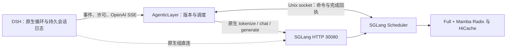

# AgenticLayer 三层设计

执行步骤见 [RUNBOOK.md](RUNBOOK.md)，对照组和证据门禁见 [实验文档](../experiments/README.md)。原始设计合同见 [论文](../main.pdf) 和 [归档方案](../experiments/DSH_AGENTICLAYER_SGLANG_PLAN.md)。

## 边界与所有权

`agenticlayer/` 是本项目新增实现，内部 Python 包名仍是 `agentic_layer`。`../sglang/` 是锁定版工程源码的软链接，只用来导航和复制，不在链接目标上构建或修改。`../deepseek-harness/` 是现有 clone；阅读或部署指定版本时以 Git 对象 `9c2670d3bce5275e0d1610272958121af87787bb` 为准，不把当前 checkout 当作该 release。

## 源码入口

| 路径 | 负责什么 |
|---|---|
| [dsh-agentic/profile.patch.yml](dsh-agentic/profile.patch.yml)、[runner.ts](dsh-agentic/src/runner.ts) | `createHarness` 用完整 `sdk` profile 启动原生 DSH；原生组直连 30080，受控组连接 30081。两组使用相同 fixture 工具；受控组接入许可。 |
| [dsh-agentic/src/index.ts](dsh-agentic/src/index.ts)、[controller.ts](dsh-agentic/src/controller.ts) | 从冻结的消息视图生成版本事件；按分支串行确认事件，不串行阻塞 sibling 等待许可。模型请求用 AsyncLocalStorage 绑定隐藏头，工具仍由 DSH 执行；委派通过原生 activation receipt 等齐终态。 |
| [fixtures.ts](dsh-agentic/src/fixtures.ts)、[tool-cache.ts](dsh-agentic/src/tool-cache.ts)、[compaction.ts](dsh-agentic/src/compaction.ts) | 快照读、纯计算、单次写入；缓存完整成功工具结果，以实现、schema、参数、快照、版本、权限和隔离域作键；复用原生同步压缩事务。 |
| [agentic_layer/protocol.py](agentic_layer/protocol.py)、[versions.py](agentic_layer/versions.py) | HTTP 与 JSON Lines 合同、事件幂等、分支 seq/版本 CAS、生命周期、已提交视图和候选视图。 |
| [agentic_layer/server.py](agentic_layer/server.py)、[engine_client.py](agentic_layer/engine_client.py) | 30081 ingress、Bearer 校验、`/v1/chat/completions`、`/agentic/v1/events`、`/agentic/v1/batch`、原生分词、`bind`、取消、回执和 epoch 失效。 |
| [agentic_layer/policy.py](agentic_layer/policy.py) | `Policy.choose` 决定动作，`Coordinator` 执行；`strong` 按子策略固定顺序选，`joint` 比较跨动作收益。`joint-on-time` 对可选准备/提前恢复另要求预计完成时间不晚于切换点。所有策略保留合法性、硬容量、老化、快照时效、在途拷贝及校准门控；未校准不做可选预测。适用窗口实测见 [固定图消融](../experiments/FIXED_GRAPH_CAMPAIGN.md)。 |
| [pyproject.toml](pyproject.toml)、[sglang_plugin.py](agentic_layer/sglang_plugin.py)、[engine_cache.py](agentic_layer/engine_cache.py) | 注册 `agentic_layer` radix 后端；socket 线程只搬消息，scheduler 线程处理真实绑定、租约、预留、原生转移回执与有条件回收。 |
| [agentic_layer/kernels.py](agentic_layer/kernels.py) | `page_size=1` 的 Full K/V 与 Mamba conv/SSM 传输 hook。开启时只使用已映射的 pinned host 地址，保留原生 stream、逐层事件和 ACK；与 Triton attention 是两个独立开关。 |

**上游对照入口：** DSH 固定版 [agent loop](https://github.com/deepseek-ai/deepseek-harness/blob/9c2670d3bce5275e0d1610272958121af87787bb/packages/core/agent-loop/src/agent.ts)、[subagent receipt](https://github.com/deepseek-ai/deepseek-harness/blob/9c2670d3bce5275e0d1610272958121af87787bb/packages/subagent/subagent/src/index.ts)、[压缩事务](https://github.com/deepseek-ai/deepseek-harness/blob/9c2670d3bce5275e0d1610272958121af87787bb/packages/compaction/compaction-basic/src/region.ts)；SGLang [scheduler](../sglang/python/sglang/srt/managers/scheduler.py)、[chat 模板和派发](../sglang/python/sglang/srt/entrypoints/openai/serving_chat.py)、[混合 radix](../sglang/python/sglang/srt/mem_cache/unified_radix_cache.py)、[L2 transfer](../sglang/python/sglang/srt/mem_cache/l2_transfer.py)、[MHA host pool](../sglang/python/sglang/srt/mem_cache/pool_host/mha.py) 和 [Mamba host pool](../sglang/python/sglang/srt/mem_cache/pool_host/mamba.py)。

## 关键不变量

- **语义不等于驻留。** DSH 的提交日志决定可见消息和工具结果；AgenticLayer 管逻辑版本；SGLang 独占物理槽位。压缩或驱逐 KV 不会删掉工具结果。兼容追加或 fork 也要通过实际 token 序列、隔离域和历史检查；不能证明兼容则使用新 namespace。Full-only 命中不是 Full+Mamba 命中。
- **许可不等于完成。** 受控请求先校验版本与许可，再向 scheduler `bind`。SGLang 对实际输入 token 复核。工具结果按原生调用 ID 持久提交；子分支等 activation 的终态而非启动 ACK；迁移只有原生完成回执才可宣布完成。原生 ACK 无法归属单动作时，不把缺失传输计数报成零。
- **失效不等于重试。** 旧 epoch 的物理句柄和许可不再使用。失去控制通道后重启 engine，按已提交状态重新建立驻留；不自动重放未确认的副作用。取消已发拷贝不能越过其原生 fence。
- **过期回收不是迁移。** 目录只对确认过期且无活跃分支引用的版本发弃置授权。引擎还核对完整前缀、lease、在途读写、host 备份与子树；未备份的孤立设备叶可直接释放，不为回收发起 D2H，也不丢弃部分已备份的叶。只有原生回执确认后才更新驻留。
- **准备不得挡住前台。** 可选候选先记 `ready` 事件，之后才分词和排队；在切换点只采纳已经原生确认的候选，并重新核验完整目标。如果前台到达时准备仍占同一分支物理槽，显式取消准备，等原生退休（包括 chunked prefill 的旁路）后再绑定前台；不把取消请求当释放回执。
- **源码接线不等于运行证明。** 通用候选可用完整原生请求体经 tokenize 和 prefill，DSH E3 提前压缩未接线：固定版在选定区域外追加也会触发 `compactRegion()` 的全视图冲突检查，现有 hook 还拿不到完整序列化目标。原生同步压缩路径保留。原生直连的模型生成摘要绕过 `agent/request`，不能与受控 greedy 摘要作为同采样配对。
