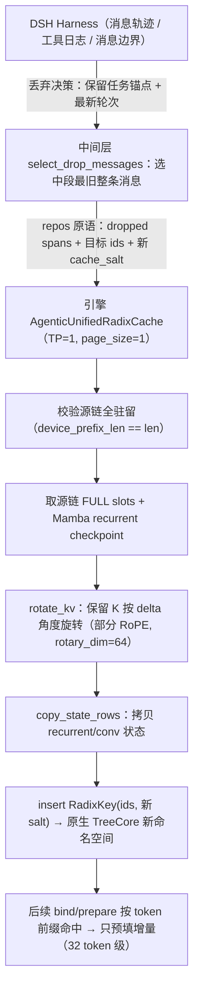
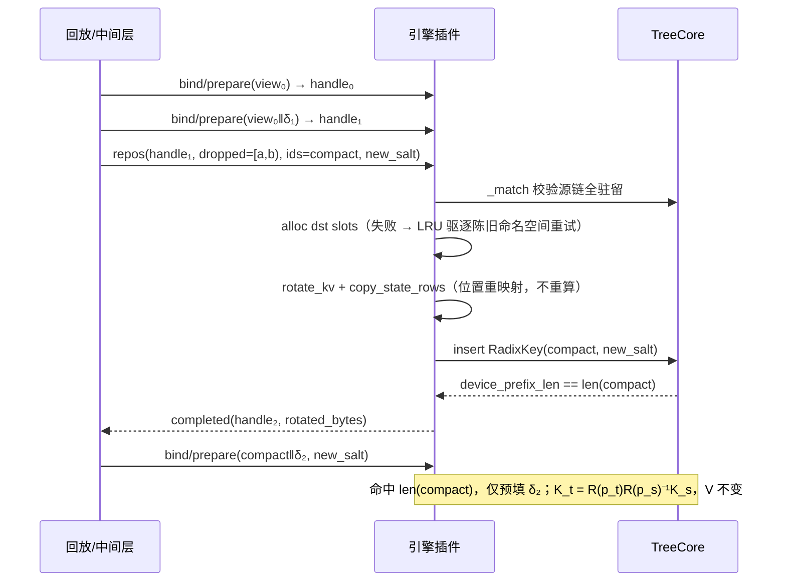
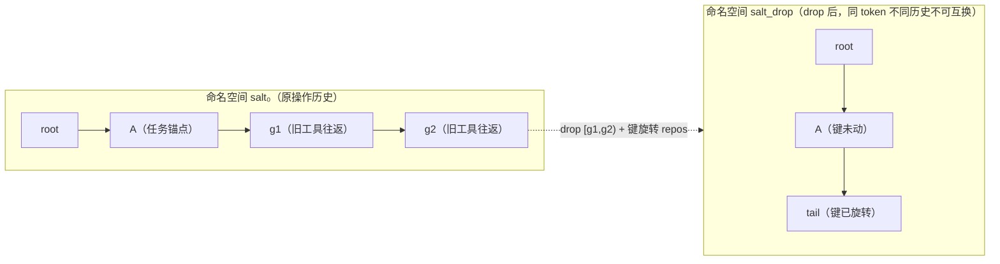

# main（1）.pdf 修改清单

依据新完成的机制与实测结果（AKV drop/repos 键旋转复用 + ActKV 消息边界丢弃，16 周 FreeInference
真实尺度三臂回放），本文件记录论文《面向智能体工作负载的跨层协同服务与 KV 缓存管理》需要修改的
描述、结论、表格与图片。**不直接改 PDF**：按下面第 1 节逐处改文字/公式/表，第 5 节的图在
`results/cache-engineering/figs/` 下（SVG 已生成）或按 mermaid 块重画。

原始数据：`experiments/results/cache-engineering/replay.json`（128 会话三臂回放全量轮次）、
`bench.json`（逐规模成本）、`trace-profile.json`（全量画像）。

## 0. 总纲：这次结果改变了论文的什么

- **状态侧（第 4 章）从「机制阶段验证」升级为「已有量化回放证据」**：新增了一条版本转移的工程路径
  ——drop + repos 键旋转复用（AKV），把压缩点后的「完整重预填」降为「字节拷贝」，并配套
  ActKV 动作感知保留的消息边界丢弃策略。
- **第 4 章 I5 的表述需要修正**：完整预填充仍是构造正确性参照，但键旋转是经校准的等价实现路径，
  论文现文「必须以完整预填充为正确性参照」读起来像「只能重预填」，需要改写。
- **摘要 / ABSTRACT / 第 6 章局限性(1) 需同步改写**：状态侧已有可复核量化结果（2.7×/3.5× re-prefill
  缩减、P95 1.8×），执行侧与联合控制（E5/E6）维持原状。

## 1. 逐处修改清单

| # | 位置 | 现状（PDF 要点） | 修改建议 | 类型 |
|---|---|---|---|---|
| 1 | 摘要（第 3 段）/ ABSTRACT | 「截至本文撰写时，执行并行与 KV 生命周期两个方向已完成机制层面的阶段性验证」 | 状态侧补量化一句：在 Qwen3.5-9B NVFP4 / RTX 5090 / SGLang 载体上完成 drop/repos 键旋转复用与 16 周 FreeInference 真实尺度回放（128 会话 × 30 轮），相比原生前缀缓存与「丢弃后冷启动」裁剪，re-prefill token 分别减少 2.7× 与 3.5×，TTFT P95 降低 1.8× 与 1.4×；执行侧与联合控制仍为机制阶段验证 | 文字 |
| 2 | 第 1 章 §1.2.1 AKV 条目 | 只介绍 AKV 原文机制 | 追加：本文第 4 章在单实例 SGLang 载体上实现了该原语链（消息级 drop、部分 RoPE 键旋转 repos、以新 cache_salt 命名空间扩展基数树复用），并在 8 层 full + 24 层 linear attention 的混合模型上实测 | 文字 |
| 3 | 第 1 章 §1.2.1 ActKV/MemDecay 句（现引 [43,44]） | 「通过动作或区域感知实施有损缓存淘汰」 | 补落地：保留任务锚点与最新轮次、按预算丢弃最旧中段消息（整消息边界，不切开） | 文字 |
| 4 | 第 1 章 §1.3 贡献（二）状态侧 | 五阶段版本转移、六元组、四条不变量 | 补第 4 点：「以 drop/repos 键旋转替代压缩点后的全量重预填，将版本转移关键路径成本从重算降为字节拷贝，配套消息边界丢弃策略与扩展基数树命名空间」 | 文字 |
| 5 | 第 2 章 §2.2.2 精细化演进 | 组件级（MORTIS）→ 步骤级（StepKV） | 补「注意力状态级」粒度：AKV 的 drop（可见性遮蔽）与 repos（位置重映射）直接操作活跃注意力状态，不改文本轨迹；本文载体实现见第 4 章 | 文字 |
| 6 | 第 2 章 表 2-1「本文工作」行 | 「版本与生命周期」列 = 六元组与延迟回收 | 补「drop/repos 操作历史命名空间（cache_salt）」；该行其余不变 | 表 |
| 7 | 第 2 章 §2.3.1 六元组（公式 2-2） | H 为形式化字段 | 补实现注记：H 在 SGLang 载体上落地为「每次 drop 一个新 cache_salt 命名空间」——操作历史不同的链即使 token 相同也位于不同命名空间，天然不可互换，与公式语义一致 | 文字 |
| 8 | 第 4 章 §4.1 引言 | 两条路径（同步压缩 vs 后台准备） | 加第三段对比三条路径：整窗冷预填（full）、丢弃后冷启动（trim）、丢弃后键旋转复用（cache-eng），直接点出 AKV 的核心矛盾（裁剪必然 re-prefill）及本文的工程答案 | 文字 |
| 9 | 第 4 章 §4.2 相关工作 | AKV 仅作文献 | AKV 描述后补实现与边界（见第 2 节边界清单，务必原文照录） | 文字 |
| 10 | 第 4 章 §4.3.1 表 4-1「缓存 drop / repos」行 | 正确性参照 = 相同缓存操作历史下的未驱逐执行 | 保留参照不变；补注：键旋转满足 K_t = R(p_t)R(p_s)⁻¹K_s 的数值等价经 §4.6.4 实测校准；混合模型下线性注意力（recurrent/conv）状态保留原历史摘要，与 AKV「保留 KV 携带被丢历史」同源，但不是对紧凑序列的精确重算 | 表 |
| 11 | 第 4 章 §4.4 核心方法 | 三模块 | 新增小节（建议 4.4.4）「drop/repos 键旋转复用与消息边界丢弃」：机制流（图 4-3）、repos 时序（图 4-4）、扩展基数树命名空间（图 4-5）、`select_drop_messages` 策略、竞技场回收 | 文字+图 |
| 12 | 第 4 章 §4.5.1 五阶段流程 | 步骤 3/4：目标前缀构造 = 完整预填充 | 增补：目标前缀构造存在两条等价路径——完整预填充（I5 参照）与「源链 drop + 键旋转」；当保留段来自同一源链且仅位置/可见性变化时，隐藏状态一致，仅需按 delta 角度旋转 K 并拷贝 Mamba 状态 | 文字 |
| 13 | 第 4 章 §4.5.2 不变量 I5 | 「必须以目标新文本的完整预填充作为构造正确性参照」 | 改写为：「以完整预填充为构造正确性参照；键旋转为经数值容差校准的等价实现路径，旋转后的目标版本必须与完整预填充在容差内一致」；I7 补一句：「repos 目标槽位分配失败时先按 LRU 驱逐陈旧命名空间再重试，防止竞技场耗尽回退冷启动」 | 公式/文字 |
| 14 | 第 4 章 §4.6 实验设计 | E3/E4 | 新增 4.6.4「真实尺度三臂回放与逐规模成本」：设置（第 3 节）、数据（第 4 节）、图 4-6/4-7/4-8 | 实验 |
| 15 | 第 4 章 §4.6.3 收益口径（公式 4-4） | C 为同步转换暴露成本 | 补：C 的组成按实现路径取 min 分支——完整预填充 vs 键旋转（拷贝字节/实测带宽 + 插入开销）；给 8K 算例（旋转 130 ms vs 冷预填 293 ms，第 4 节表） | 公式 |
| 16 | 第 5 章 表 5-1 八类动作空间 | 「准备/暂停候选版本」行 | 补「含 drop/repos 键旋转路径」；注记：键旋转消耗 HBM 拷贝带宽，作为可隐藏后台动作受后台准入不等式（5-6）约束 | 表 |
| 17 | 第 6 章 §6.1 工作总结（二） | 「已完成机制层面的阶段性验证」 | 补量化一句（同 #1 数字），注明证据边界（第 6 节） | 文字 |
| 18 | 第 6 章 §6.2 局限性（1） | 「KV 生命周期……尚未归档纳入本文，无法定量宣称端到端加速幅度」 | 改写：状态侧已有 16 周真实尺度回放证据（re-prefill 2.7×/3.5×、P95 1.8×），但仍缺任务质量评测、真实 DSH 闭环接线与专用旋转核；执行侧与联合控制（E5/E6）仍未闭环 | 文字 |
| 19 | 第 6 章 §6.3 未来工作（1）（3） | 泛泛 | 补三项：DSH 消息级丢弃闭环（dsh-agentic → 中间层 → 引擎 repos 下发）、Triton 旋转核、fixture 通过率质量门禁 | 文字 |

## 2. 哪些 idea 与实现表述需要修改（论文现文 ↔ 实际实现）

1. **I5 的工程含义**。论文现文读作「前缀改写后旧后缀 KV 只能完整重预填」。实际实现（AKV retrigger match）：
   同一源链上 drop 中段后，保留段的隐藏状态不变，仅 K 的旋转角度变，`K_t = R(p_t)R(p_s)⁻¹K_s`、
   `V_t = V_s`，按 delta 角度旋转即可复用——I5 应改为「参照」而非「唯一路径」。
2. **版本转移成本模型（4-4）**。C 不再恒等于重预填成本，而是
   `C = min(完整预填充, 键旋转拷贝 + 插入)`；旋转成本 = 保留 token × 槽位字节 / 实测带宽。
3. **六元组 H 的落地语义**。论文只定义字段；实现里 H = 每次 drop 一个新 `cache_salt` 命名空间
   （SHA-256 注入引擎，客户端不可自供），不同操作历史的链物理隔离，避免「同 token 不同历史」误命中。
4. **丢弃粒度 = 消息边界**。实现中 drop span 只能是整条消息（轨迹请求 = DSH 消息）的并集，
   `select_drop_messages` 保留任务锚点（初始窗口）+ 最新轮次，从不切开一条消息——chat 模板合法性
   由构造保证。论文 §4.3.1 表 4-1 的 drop 行未强调粒度，需补。
5. **混合模型语义**。Qwen3.5-9B 为 8 层 full attention + 24 层 linear attention：drop 只改变
   full-attention 的可见 KV；linear 层的 recurrent/conv 状态保留「原历史摘要」——与 AKV「保留的 KV
   仍携带被丢弃历史的信息」同源，但**不是对紧凑序列的精确重算**。论文任何「drop 后等价」表述必须加此限定。
6. **repos 的资源失败处理**。真实尺度下竞技场被逐次新 salt 的旧链填满，`_op_repos` 分配失败必须先
   LRU 驱逐陈旧命名空间再重试（对齐 `_op_bind`）——这是真实尺度才暴露的工程问题，论文若描述
   实现细节应写入。
7. **旋转的实现形态**。当前是每次 drop 一次的 eager torch 拷贝（Qwen3.5 rotary_dim=64、
   head_dim=256、theta=1e7、交错对），未写专用 Triton 核；论文写「键旋转」时注明实现形态与成本口径
   （第 4 节逐规模表）。

## 3. 新增实验设置（写入第 4 章 §4.6.4）

### 3.1 载体与硬件

| 项 | 值 |
|---|---|
| 模型 | AxionML/Qwen3.5-9B-NVFP4（32 层：8 full + 24 linear attention），NVFP4 权重 / BF16 KV |
| GPU | RTX 5090（32 GB），驱动 580.95.05 / CUDA 13 |
| 引擎 | SGLang `703e763d`（固定 revision），Python TreeCore，Triton attention，page_size=1 |
| 关键引擎参数 | context-length 32774、chunked-prefill 2048、mem-fraction-static 0.80、max-running-requests 8、mamba-radix-cache-strategy no_buffer、hybrid-cache-checkpoints-level 2、radix-eviction-policy lru、TP=1 |

### 3.2 三臂回放设置

| 项 | 值 |
|---|---|
| 数据 | FreeInference 16 周全部周次（`release/*/traces/*.jsonl.zst`），每周末 8 条真实根会话，共 128 会话（12,002 的 1.07%，SHA-256 确定性采样） |
| 投影 | 每个 16-token 轨迹 block 按 SHA-256(week, block_id) 投影为 8 个稳定合成 token id（引擎成本按真实 token 量级计） |
| 窗口 | 初始视图 = 会话最后 2,750 block（22K token）；32K token 窗口滑落保护（引擎上限内） |
| 轮次 | 每会话最多 30 轮（此前 12 轮从未触发窗口溢出，full 臂被错误地测得「便宜」） |
| 三臂 | `full`（不丢弃，窗口滑落时整窗冷预填）/ `trim`（同丢弃后冷启动，模拟今日压缩路径）/ `cache-eng`（同丢弃后 repos 旋转复用） |
| 丢弃决策 | `select_drop_messages`：任务锚点 + 最新轮次保留，中段最旧整条消息丢弃，从未切开消息 |
| 计量 | 每轮 prefill-only 请求物化候选前缀（= 中间层 prepare），收据 `full_kv_hit_length` 为实际命中，prefill token = prompt − 命中；TTFT 取引擎 prefill 时间戳差 |

### 3.3 单点探针与逐规模成本

- 探针：2048→drop[512,1024) 保留 1536，复用后 prefill 32 vs 冷 1568；8192→drop 2048 保留 6144，
  prefill 32 vs 冷 6176（`repos_probe.py`）。
- 逐规模：1K/4K/8K 前缀丢弃 25% 中段，测 repos（拷贝+旋转+插入）与冷预填同一紧凑序列
  （`cache_engineering_bench.py`，每规模 3 次重复取中位）。

## 4. 数据表现（论文表格的替换/新增内容）

### 4.1 全量画像（16 周完整扫描，非抽样）

| 观测 | 值 |
|---|---|
| 根会话 / 递归请求 / 工具调用 | 12,002 / 1,222,199 / 1,275,252 |
| 上下文长度 P50 / P95 | 118,080 / 496,080 token |
| 可复用前缀 P50 | 116,160 token |
| 前缀改写事件（mutation + switch） | 45,099 + 8,699 = 53,798 |

### 4.2 单点探针（repos 复用 vs 冷启动）

| 规模 | 保留 token | repos 后 prefill | 冷启动 prefill | 缩减 |
|---|---|---|---|---|
| 2,048 → drop 512 | 1,536 | **32** | 1,568 | 49× |
| 8,192 → drop 2,048 | 6,144 | **32** | 6,176 | 193× |

### 4.3 每次丢弃的成本（repos vs 冷预填，同次运行）

| 源长度 | 丢弃 | 保留 | 旋转字节 | repos ms | 冷预填 ms | CE 总计 ms |
|---|---|---|---|---|---|---|
| 1,024 | 256 | 768 | 24 MiB | 222（含首次编译） | 85.4 | 303.6 |
| 4,096 | 1,024 | 3,072 | 96 MiB | 42.1 | 155.5 | 124.1 |
| 8,192 | 2,048 | 6,144 | 192 MiB | 130.1 | 293.4 | 213.5 |

### 4.4 真实尺度三臂回放（128 会话 × ≤30 轮，三臂各 3,145 轮）

| 臂 | prefill token | 复用 token | prefill 墙钟 | TTFT P50 | TTFT P95 |
|---|---|---|---|---|---|
| full（不丢弃，窗口滑落） | 26,063,160 | 44,362,000 | 1,580.1 s | 74.0 ms | 1,715.2 ms |
| trim（丢弃后冷启动） | 33,166,136 | 22,793,992 | 1,648.7 s | 154.7 ms | 1,383.2 ms |
| cache-eng（丢弃 + 键旋转复用） | **9,592,952** | 46,367,176 | **687.9 s** | **72.0 ms** | **955.3 ms** |

- re-prefill：cache-eng 比 full 少 **2.7×**、比 trim 少 **3.5×**；TTFT P95 比 full 快 **1.8×**、
  比 trim 快 **1.4×**；prefill 墙钟 2.3× / 2.4×。
- **1,120 次消息级丢弃全部经 repos 旋转复用，零回退**；full 臂 811/3,145 轮触发窗口滑落整窗冷预填
  （P95 主因），trim/cache-eng 滑落仅 150 轮。

## 5. 新增图清单（建议编号按第 4 章顺延为图 4-3 … 4-8）

**图 4-3 缓存工程机制流**（放 §4.4.4，替代「只能重预填」的心智模型）：

**图 4-4 repos 键旋转时序**（放 §4.5.1 步骤 3/4 的增补处）：

**图 4-5 扩展基数树命名空间**（放 §4.4.4，示意操作历史隔离）：

**图 4-6 每次丢弃的成本随上下文规模**（放 §4.6.4，数据 = 4.3 表）：

**图 4-7 三臂逐轮平均 TTFT**（放 §4.6.4，数据 = replay.json 逐轮聚合）：

**图 4-8 三臂累计 re-prefill token**（放 §4.6.4）：

PDF 重画建议：图 4-6/4-7/4-8 的折线坐标与图注直接取自 SVG 内的数据点（见 §4.4 表与
`replay.json` 的 `rows[].turns[]`），换论文配色与中文字体即可，不需要重测。

## 6. 边界声明（论文必须原文照录，否则数字不可解释）

1. **无任务质量评测**：FreeInference 轨迹匿名，无原始文本/真实工具结果，三臂回放衡量的是引擎成本
   （prefill token、TTFT、墙钟），不是任务质量；丢弃的精度影响需 fixture 通过率另行判定。
2. **旋转为 eager torch 拷贝**：未写专用 Triton 核，逐规模成本表含此实现形态；Triton 化是未来工作。
3. **full 臂口径**：原生 radix 前缀复用 + 窗口滑落时整窗冷预填（无后缀复用）——这是标准 SGLang
   行为，也是 AKV 的动机来源，不是被刻意削弱的基线。
4. **采样**：每周末 8 会话（1.07%），SHA-256 确定性采样，16 周全覆盖；投影为 8 ids/block 合成 token，
   不可解释为原文。
5. **丢弃粒度**：整条轨迹请求 = 一条 DSH 消息；真实 DSH 闭环（工具往返粒度 + 中间层 repos 下发）
   尚未接线，属未来工作。
6. **混合模型语义**：linear attention 状态保留原历史摘要（见第 2 节第 5 条），与 AKV 同源而非精确重算。
